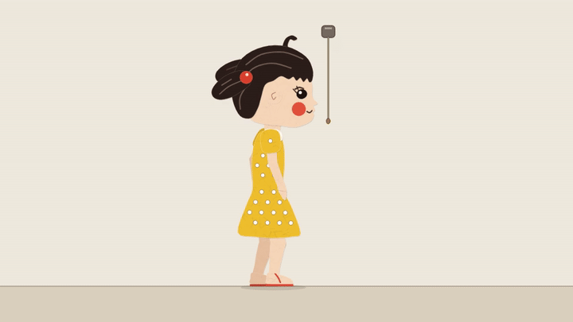

# 3秒代码关节动作小样：v2实片与独审

**已做出连续的程序关节动作小样；这不证明连续生图能力，也不是可直接采用的正式镜头。** 本次严格限于一个单镜头，没有扩成全片改造。

## 先看实际预览

- [普通画面 MP4](motion_normal.mp4)：960×540、24fps、72帧、3.000秒，静音。平足→踮脚伸手→闭指握绳→下拉→松指撤手→落跟。
- [骨架与接点 MP4](motion_skeleton.mp4)：相同动作的诊断叠加，不代替普通画面观感。
- 上方GIF为720×405缩小预览；验收依据是原始24fps MP4与[72张实际普通帧](normal_frames/manifest.json)，没有用补帧或换姿态图凑帧数。

## 审查结论分开说明

| 项目 | 本次结论 |
| --- | --- |
| 单侧面动作的技术连续性 | 有限通过：肩肘腕、髋膝踝各段连续变化；前掌接地点保持，脚跟升降；指形连续握放，绳随手拉动、放开后分离回弹。不是整张人物图平移。 |
| v1两处明显问题 | v2已关闭持续钩指与腰部分片亮缝。手部独审实看F24–56共33张连续原帧；完整动作独审另核其回归。 |
| 正式小满造型兼容 | 不通过。大头侧脸、黑豆眼、圆红腮、发束与身形比例仍与既定角色不同。白点裙和去腰带只缩小部分差异，不能当作新美术批准。 |
| 正常速度的自然表演与重量感 | 未完成观感验收。审查工具能逐帧看图及检查时间戳，不能把视频时序直接送入视觉模型实时观看；没有伪称原速看完。几何日志和完整帧数不能代替这一关。 |
| 连续生图能力 | 仍无可靠通过实证。本片全部动作来自固定程序角色、关节函数与接触约束，没有调用图像/视频生成。 |

详细见[完整动作v2独审](independent_motion/v2/report.md)、[v1问题原报告](independent_motion/v1/report.md)和[第二位审查者的v2手部补审](independent_character/v2_addendum.md)。当前动作有准备、上升、下拉、释放、落稳的阶段，但表情少，脚板仍按剪纸刚体处理；身体轨迹是协调运动学设计，不是质量/力学平衡仿真。不能从这个侧面小样外推走路、翻身、转面或整片质量。

## 实现与可复验范围

新独立分支 `codex/astra-motion-proof-20261017`，固定提交 `0e351c7a0f47877abab5ad813bd19892f50ef876`。只新增6项：两份motion源码、两份渲染/约束工具、播放页和说明；原cut代码、镜头、EDL、声音没有被这次小样修改。基线继承93a6e9f的冻结历史，不意味着其S14/S31实验已通过。

这6项已从远端下载逐字节核对一致，[读回记录](remote_0e351c7_verified.json)。运行仓库的`npm run serve`，打开`/dev/motion/proof.html`可播放、拖动时间及切换骨架；[实际UI验证](v2/ui_check.json)已检查暂停、寻帧、叠加、继续，无页面报错。

v2两支MP4都已完整解码成功。两组渲染前后7个来源哈希一致，逐帧记录可追溯；代码提交发生在渲染后，实际源码哈希与提交对应，不把渲染清单里的旧基线HEAD误作新源码版本。[交付身份](v2/delivery_manifest.json)、[作者自评](v2/author_review.md)、[721个时刻的约束复核](v2/root_constraint_check.json)。数值只验证固定骨长、接点和足底约束，不作审美评分。

v2与v1的身体、头、腕、绳、腿脚72帧状态相同，仅修改连续指骨终角/拇指对握和连衣裙轮廓。v1视频、源码和报告完整保留，不覆盖错误证据。无新增生图、付费生成或旧Blender启动。

## 前一批保存与本次边界

用户原话、静图路线结论和冻结版本已经在协作提交75e82ba保存，[8个关键文件读回记录](remote_75e82ba_verified.json)确认一致。原文见[上一批路线记录](../20261017_0714_motion_route/README.md)。本次没有改写用户原话或Opus留言，也没有向Opus协作分支合入实现。

旧全24fps批渲队列保持暂停；通知时已在渲的S17最终收口为336帧/14秒，已完整解码，[状态与哈希](paused_S17_completed.json)。S18和后续未启动，未因此宣称完整新全片已完成。

可以向用户和Opus如实说明：**代码多关节动画已有可看的小范围实证，值得按正式人物设计继续评估；现有小样尚不足以批准全片换装或保证成片效果。连续生成稳定动作图片的承诺仍不能给出。**
