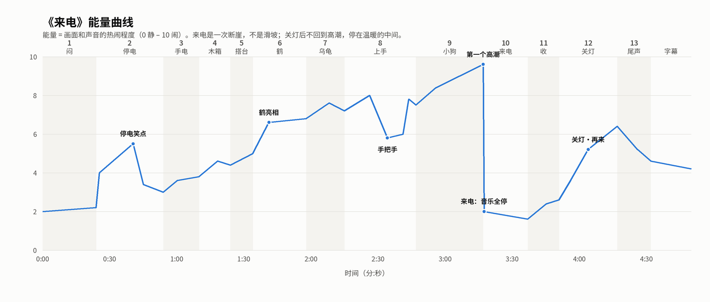

# 节拍表与能量曲线

数据源：`src/laidian/beats.py`（动态分镜和音乐小样也读它）。图：`tension-curve.png`（`python tools/draw_tension.py` 生成）。

| 场 | 名称 | 起止 | 时长 | 光 | 声音/音乐 | 这一场要让观众感到什么 |
|---|---|---|---|---|---|---|
| 1 | 闷 | 0:00–0:24 | 24s | 日光灯：平、白、冷 | 无配乐；蝉、蛙、吊扇、电视人声 | 两个人在同一间屋里，各过各的 |
| 2 | 停电 | 0:24–0:54 | 30s | 全黑 → 月光（蓝）→ 马灯（暖） | 电器声一个个停下，虫声显出来 | 笑：拔了又插、瘫倒；奶奶的从容 |
| 3 | 手电 | 0:54–1:10 | 16s | 马灯 + 手电乱照 | 手电咔嗒、壁虎 | 孩子自己找乐子；老照片一闪 |
| 4 | 木箱 | 1:10–1:24 | 14s | 透过皮影的彩色光斑 | 箱扣、布料窸窣 | 好奇，又嘴硬 |
| 5 | 搭台 | 1:24–1:34 | 10s | 床单亮起 | 衣夹、床单抖开 | 期待；"倒要看看" |
| 6 | 鹤 | 1:34–1:58 | 24s | 马灯透射，彩色玻璃般 | **配乐进入**：笛子主旋律 + 梆子点步子 | 惊艳 |
| 7 | 乌龟 | 1:58–2:15 | 17s | 马灯 | 小锣、梆子给啄和撞点 | 笑出声 |
| 8 | 上手 | 2:15–2:47 | 32s | 背面：被照亮的半边脸和手 | 音乐跟着踉跄；手把手只剩笛子；咬嘴一声锣 | 乱、笑、一瞬间的亲近、马上又笑 |
| 9 | 小狗 | 2:47–3:17 | 30s | 马灯 + 手电，两种影子 | **芯片音色加入丝竹**，越来越快 | 第一个高潮：老戏演成新戏 |
| 10 | 来电 | 3:17–3:37 | 20s | 日光灯：惨白、刺眼 | **音乐整段停下**（全片唯一一次）；电器声一连串 | 突然的空白（好笑，不吓人） |
| 11 | 收 | 3:37–3:51 | 14s | 日光灯 | 手机开机"叮咚"、吊扇、电视 | 奶奶识趣；小满犹豫 |
| 12 | 关灯 | 3:51–4:17 | 26s | 马灯重新显出 + 手电 | 咔嗒后静；旋律先轻后完整地回来 | 释放：一个小动作；奶奶鼓腮的笑点 |
| 13 | 尾声 | 4:17–4:32 | 15s | 屋外：村子白灯，这扇窗暖黄 | 主旋律完整收尾 | 温暖收尾；片名 |
| — | 字幕 | 4:32–4:50 | 18s | — | 主题尾声 | 最后一张：手机锁屏上的鹤影 |

**总长约 4:50。** 鹤在 1:34 亮相：前面 5 场铺垫控制在一分半以内，开头不拖。

## 节奏原则
- 第 1 场的"闷"要靠表演和小动作撑住：观众觉得人物无聊，但自己不能觉得无聊。
- 第 2 场的笑点有节奏：按电源（快快快）→ 拔线看（停）→ 吹（停）→ 插（快）→ 再拔再插（更快）→ 瞪插座（长停）→ 狠插回去 → 倒下（慢动作似的瘫）。
- 第 6–9 场一路上升，中间第 8 场手把手是唯一一个下沉，必须短（3–4 秒），马上用"咬嘴"顶回去。
- 第 10 场是断崖：上一帧最闹，下一帧最白。不留过渡。
- 第 12 场只回到"温暖的中间"，不再造一个高潮。
