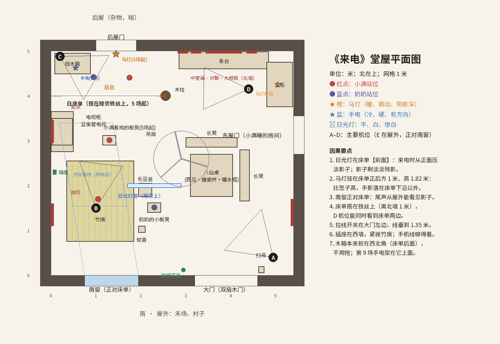
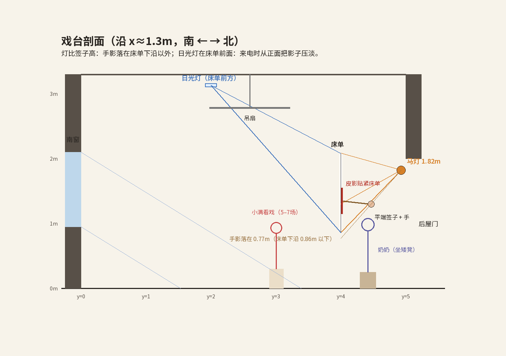

# 堂屋平面图

- 数据源：`src/laidian/layout.py`。渲染器、平面图、镜头都读同一份数据，门窗、家具、光源在任何镜头里都对得上。
- 重新生成：`python tools/draw_floorplan.py`

## 房间
- 室内 5.4 m（东西）× 5.0 m（南北），檩条下 3.3 m。砖墙抹灰，下半截刷了绿漆墙裙，水泥地。
- **南墙**：西侧一扇木框玻璃窗（正对床单），东侧是双扇木大门；大门左边是拉线开关和吊扇调速器。
- **北墙**：西侧是通往后屋的门；东侧是条台，上面挂中堂画（松鹤，原创）、对联和一个装满老照片的大相框。
- **西墙**：电视柜和显像管电视（朝东），上方挂着小满妈妈小时候的奖状；挂历；插座紧挨竹席。
- **东墙**：东屋门（小满暑假睡的房间），立柜（马灯原来放在柜顶），墙上钉子挂着衣服。
- **北侧**：一根露明木柱（带石础），晾衣铁丝从西墙拉到柱子上，平时晾毛巾和衣服；第 5 场起搭上白床单。

## 生活逻辑（为什么东西在那儿）
- 竹席铺在西边的地上：离插座近（孩子要充电），夏天贴着水泥地凉快。
- 奶奶的小板凳在竹席旁边：剥毛豆时能看着孙女。
- 八仙桌在中间偏东：吃饭的地方，西瓜、暖水瓶、搪瓷杯都在上面。
- 旧木箱在西北角：平时用不上的东西放墙角——正好在后来床单的后面。
- 马灯在立柜顶：停电才用，平时收在高处。

## 光源
| 光源 | 位置 | 何时亮 | 性质 |
|---|---|---|---|
| 日光灯管 | 堂屋中间房梁上（床单前 2 米、高 3.15 米） | 第 1 场；第 10–11 场 | 平、白、冷，惨白；吊扇叶片在地上投下转动的影子 |
| 月光 | 南窗斜射进来，落在竹席北半边 | 第 2–3 场最明显，之后一直有 | 蓝、淡，带窗格的影子 |
| 马灯 | 第 2–4 场在立柜/木箱旁，第 5 场起挂在后屋门楣（床单正后方 1 米、高 1.82 米） | 第 2 场点亮后一直亮着 | 暖、跳动、阴影深；火苗 + 被熏黄的玻璃罩 = 中心锐、外圈虚的双层阴影 |
| 手电 | 第 3 场在小满手里；第 9 场架在木箱上 | 第 3 场起；一直没关 | 冷、硬、有方向 |
| 电视屏幕 | 西墙 | 第 1 场；第 10–11 场 | 闪烁的彩色杂光，很弱 |
| 手机屏幕 | 竹席上 | 第 1–2 场；第 10–11 场 | 蓝白，只照亮小满的脸 |
| 窗外村子 | 南窗外远处 | 停电前、来电后 | 远处一点点白灯；停电全黑，来电全亮 |
